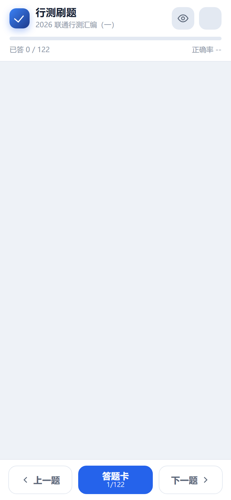

# 行测刷题 · 2026 联通行测汇编（一）

手机端刷题 PWA。把原来的网页题库整理成了适合手机操作的单页应用，含答案与解析，支持错题、收藏、背题、随机练习和离线使用。



## 在线使用

- **刷题地址**：https://hyper90124.github.io/liantong-shuati/
- 手机浏览器打开后，建议「添加到主屏幕」，即可像 App 一样全屏使用并离线刷题。

| iPhone / iPad (Safari) | Android (Chrome) |
| --- | --- |
| 分享按钮 → 添加到主屏幕 | 右上角菜单 → 安装应用 / 添加到主屏幕 |

## 功能

- 122 道单选题（含 5 道材料题），全部带正确答案与解析
- 顺序练习 / 随机练习 / 错题练习 / 收藏练习
- 背题模式：一键显示答案与解析
- 答题后即时判对错，自动展开解析，可单题「重做」
- 答题卡：总览作答情况，点击题号跳转
- 自动保存进度（localStorage），关闭页面后可继续
- 深色模式、左右滑动切题、键盘方向键切题
- PWA：可安装到桌面，Service Worker 缓存后离线可用

## 本地运行

纯静态站点，无需构建。任选一种方式：

```bash
# Node
npx serve .

# Python
python -m http.server 4173
```

然后访问 `http://localhost:4173/`。

## 目录结构

```
index.html              页面骨架
styles.css              样式（移动端优先 + 深色模式）
app.js                  交互逻辑
data.js                 题库数据（由抓取结果生成）
manifest.webmanifest    PWA 配置
sw.js                   Service Worker（离线缓存）
assets/icon.svg         PWA 图标
assets/img/             题目中的图片（本地化）
```

## 数据来源与声明

- 题库内容抓取自：<https://www.zhixiaoxiang.com/web/exam/answer?id=1773302697&courseid=1756092842>
- 内容版权归原网站及原作者所有，本项目仅用于个人学习与复习，请勿用于商业用途。
- 如原作者或版权方认为不妥，可联系删除。

## 说明

- 所有记录只保存在浏览器本地（localStorage），不会上传到任何服务器。
- 清空浏览器数据会同时清空做题记录。
